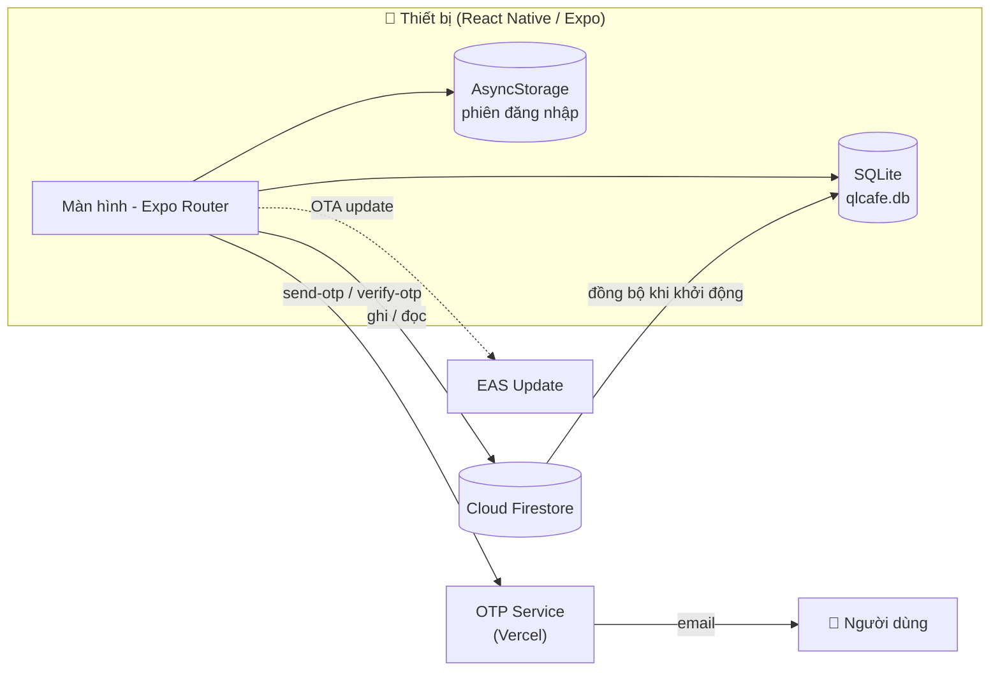
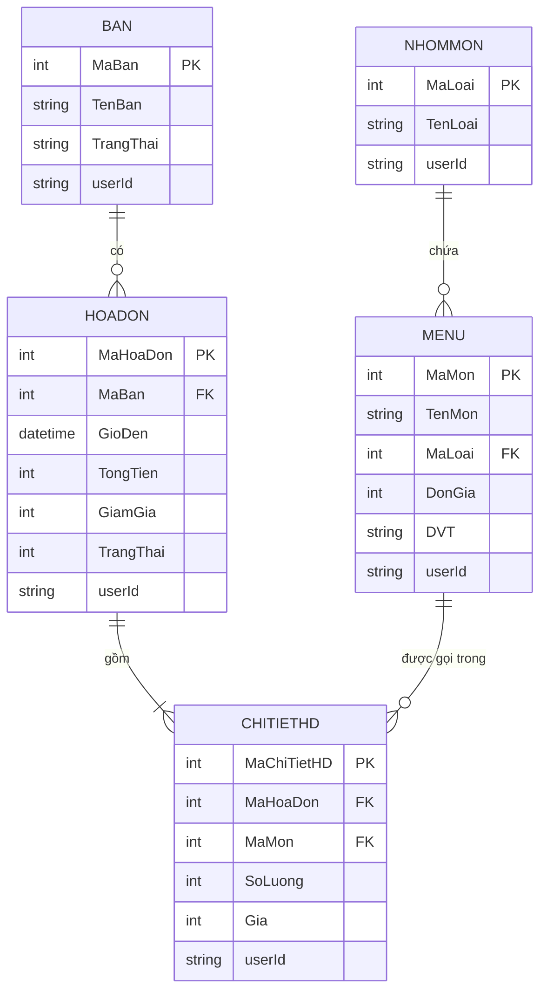

<div align="center">


# CaféGo

### Ứng dụng quản lý quán cà phê (POS) đa nền tảng cho chủ quán Việt

Quản lý bàn, gọi món, thanh toán, in hóa đơn và theo dõi doanh thu — tất cả trong một ứng dụng di động, hoạt động **offline-first** và đồng bộ đám mây với Firebase.

[](https://expo.dev)
[](https://reactnative.dev)
[](https://www.typescriptlang.org)
[](https://firebase.google.com)
[](https://docs.expo.dev/versions/latest/sdk/sqlite/)
[](#)
[](https://github.com/quochuyph/CafeGo/actions/workflows/ci.yml)
[](LICENSE)

[Tính năng](#-tính-năng-nổi-bật) •
[Công nghệ](#-công-nghệ-sử-dụng) •
[Kiến trúc](#-kiến-trúc-hệ-thống) •
[Cài đặt](#-cài-đặt--chạy-dự-án) •
[Build & Phát hành](#-build--phát-hành) •
[Lộ trình](#-lộ-trình-phát-triển)

</div>

---

## 📖 Giới thiệu

**CaféGo** là ứng dụng di động giúp các quán cà phê vừa và nhỏ số hoá toàn bộ quy trình bán hàng: từ sơ đồ bàn, gọi món, tính tiền cho đến báo cáo doanh thu cuối ngày. Ứng dụng được thiết kế cho nhân viên thao tác nhanh trên điện thoại, không cần đầu tư máy POS đắt tiền.

**Điểm khác biệt:**

- ⚡ **Offline-first** — dữ liệu được lưu cục bộ bằng SQLite nên thao tác tức thì, vẫn dùng được khi mạng chập chờn.
- ☁️ **Đồng bộ đám mây** — mọi thay đổi được ghi lên Cloud Firestore và tự động khôi phục khi đăng nhập trên thiết bị mới.
- 🔐 **Bảo mật** — mật khẩu băm bằng `bcrypt`, xác minh email và khôi phục mật khẩu bằng mã OTP.
- 🚀 **Cập nhật OTA** — phát hành bản vá ngay lập tức qua EAS Update, không cần chờ duyệt store.

## 📱 Ảnh chụp màn hình

> Thêm ảnh chụp vào thư mục [`docs/screenshots/`](docs/screenshots) với đúng tên file bên dưới để hiển thị.

| Chào mừng | Đăng nhập | Tổng quan | Sơ đồ bàn |
| :---: | :---: | :---: | :---: |
|  |  |  |  |
| **Gọi món** | **Thanh toán** | **Hóa đơn & doanh thu** | **Thực đơn** |
|  |  |  |  |

## ✨ Tính năng nổi bật

### 🔐 Xác thực & Tài khoản
- Đăng ký / đăng nhập bằng username, mật khẩu được băm `bcrypt` trước khi lưu.
- Xác minh email và **quên mật khẩu bằng mã OTP** gửi qua email (có đếm ngược gửi lại).
- Chỉnh sửa username, tên hiển thị, email (xác minh lại OTP), đổi mật khẩu.
- Đăng xuất an toàn: xoá toàn bộ dữ liệu cục bộ của người dùng trên thiết bị.

### 🪑 Quản lý bàn
- Sơ đồ bàn trực quan, tìm kiếm nhanh theo tên.
- Thống kê trạng thái theo thời gian thực: **Trống / Đặt trước / Đang phục vụ**.
- Đặt bàn, huỷ đặt bàn, thêm / sửa / xoá bàn.

### 🧾 Gọi món & Thanh toán
- Tìm kiếm món theo tên, chọn số lượng, xem danh sách món đã gọi và tạm tính.
- Màn hình thanh toán: nhập tiền khách đưa, **tự động tính tiền thối lại**.
- **In hóa đơn** (`expo-print`) hoặc thanh toán kèm in chỉ với một chạm.

### 🍽️ Quản lý thực đơn
- CRUD **nhóm món** (Cà phê, Trà, Sinh tố, …).
- CRUD **món** với đơn giá, đơn vị tính, định dạng tiền tệ VND.

### 📊 Hóa đơn & Doanh thu
- Danh sách hóa đơn theo ngày, trạng thái thanh toán.
- Tổng hợp **doanh thu đã thanh toán trong ngày**.

### 🎨 Trải nghiệm
- Giao diện **Light / Dark mode** tự động theo hệ thống, font Poppins.
- Hỗ trợ New Architecture của React Native, edge-to-edge trên Android.

## 🛠 Công nghệ sử dụng

| Hạng mục | Công nghệ |
| --- | --- |
| **Framework** | [React Native 0.81](https://reactnative.dev) · [Expo SDK 54](https://expo.dev) · New Architecture |
| **Ngôn ngữ** | TypeScript (strict mode) |
| **Điều hướng** | [Expo Router 6](https://docs.expo.dev/router/introduction/) (file-based routing, typed routes) |
| **Lưu trữ cục bộ** | [expo-sqlite](https://docs.expo.dev/versions/latest/sdk/sqlite/) · AsyncStorage |
| **Backend / Cloud** | Firebase Authentication · Cloud Firestore · Cloud Functions |
| **Dịch vụ OTP** | REST API (Node.js, triển khai trên Vercel) gọi qua `axios` |
| **Bảo mật** | `bcryptjs`, `expo-crypto` |
| **Tiện ích** | `expo-print`, `expo-sharing`, `moment`, `numeral` |
| **UI / Animation** | `react-native-reanimated`, `react-native-gesture-handler`, `@expo/vector-icons` |
| **DevOps** | EAS Build · EAS Submit · EAS Update (OTA) · GitHub Actions |
| **Chất lượng code** | ESLint (`eslint-config-expo`), TypeScript type-check, EditorConfig |

## 🏗 Kiến trúc hệ thống



**Luồng dữ liệu offline-first:**

1. Khi mở ứng dụng, `dashboard` kéo dữ liệu của người dùng từ Firestore và ghi vào SQLite.
2. Các màn hình đọc dữ liệu từ SQLite để hiển thị tức thì.
3. Mỗi thao tác tạo / sửa / xoá được ghi đồng thời vào SQLite và Firestore.
4. Khi đăng xuất, dữ liệu cục bộ của người dùng được xoá khỏi thiết bị.

### Mô hình dữ liệu



> Mỗi bản ghi gắn với `userId` — dữ liệu của từng chủ quán được cô lập hoàn toàn (multi-tenant).

## 📂 Cấu trúc dự án

```text
CafeGo/
├── .github/                  # CI workflow, issue & PR templates
├── assets/                   # Ảnh, icon, font (Poppins)
├── credentials/              # 🔒 Service account Google Play (gitignored)
├── docs/screenshots/         # Ảnh chụp màn hình cho README
├── src/
│   ├── app/                  # Expo Router – mỗi file là một màn hình
│   │   ├── _layout.tsx       # Root layout: theme, font, SQLite provider, stack
│   │   ├── index.tsx         # Màn hình chào mừng
│   │   ├── dashboard.tsx     # Tổng quan + đồng bộ Firestore → SQLite
│   │   ├── (auth)/           # Đăng nhập, đăng ký, OTP, quên mật khẩu
│   │   ├── (account)/        # Thông tin & chỉnh sửa tài khoản
│   │   ├── (orders)/         # Sơ đồ bàn, gọi món, thanh toán, hóa đơn
│   │   └── (management)/     # Quản lý bàn, nhóm món, thực đơn
│   ├── components/           # Component tái sử dụng
│   │   ├── ui/               # Button, Card, Input
│   │   └── payment/          # PaymentModal
│   ├── config/               # env.ts (biến môi trường), firebase.ts
│   ├── constants/            # Hằng số ứng dụng (tên, phiên bản, DB)
│   ├── database/             # Schema & khởi tạo SQLite
│   ├── hooks/                # Custom hooks (theme, auth storage)
│   └── theme/                # Bảng màu, font, Light/Dark theme
├── .env.example              # Mẫu biến môi trường
├── app.json                  # Cấu hình Expo
├── eas.json                  # Cấu hình EAS Build / Submit
└── package.json
```

> Thư mục trong ngoặc như `(auth)` là [route group](https://docs.expo.dev/router/advanced/shared-routes/) của Expo Router — chỉ dùng để tổ chức code, **không** ảnh hưởng tới URL.

## 🚀 Cài đặt & Chạy dự án

### Yêu cầu

- [Node.js](https://nodejs.org) ≥ 20 LTS và npm
- Ứng dụng [Expo Go](https://expo.dev/go) trên điện thoại, hoặc Android Studio / Xcode (emulator)
- Một project [Firebase](https://console.firebase.google.com) đã bật **Cloud Firestore**

### 1. Clone & cài đặt

```bash
git clone https://github.com/quochuyph/CafeGo.git
cd CafeGo
npm install
```

### 2. Cấu hình biến môi trường

```bash
cp .env.example .env
```

Mở `.env` và điền thông tin Firebase (Project settings → General → Your apps → Web app) cùng URL dịch vụ OTP:

```dotenv
EXPO_PUBLIC_FIREBASE_API_KEY=your-api-key
EXPO_PUBLIC_FIREBASE_PROJECT_ID=your-project-id
# ...
EXPO_PUBLIC_ACCOUNT_OTP_API_URL=https://your-account-otp-service.example.com
EXPO_PUBLIC_PASSWORD_RESET_API_URL=https://your-password-reset-service.example.com
```

> [!IMPORTANT]
> Không bao giờ commit file `.env` hay thư mục `credentials/`. Cả hai đã được thêm vào `.gitignore`.

### 3. Chạy ứng dụng

```bash
npm start          # Khởi động Metro bundler, quét QR bằng Expo Go
npm run android    # Mở trên Android emulator / thiết bị
npm run ios        # Mở trên iOS simulator (macOS)
```

## 📜 Scripts

| Lệnh | Mô tả |
| --- | --- |
| `npm start` | Khởi động Metro bundler |
| `npm run android` / `ios` / `web` | Chạy trên nền tảng tương ứng |
| `npm run lint` / `lint:fix` | Kiểm tra / tự sửa lỗi ESLint |
| `npm run typecheck` | Kiểm tra kiểu TypeScript |
| `npm run doctor` | Kiểm tra sức khoẻ dự án Expo |
| `npm run build:preview` | Build APK nội bộ để test |
| `npm run build:prod` | Build AAB production cho Google Play |
| `npm run submit:android` | Đẩy bản build lên Google Play (internal track) |
| `npm run update` | Phát hành bản cập nhật OTA qua EAS Update |

## 📦 Build & Phát hành

Dự án sử dụng [EAS](https://docs.expo.dev/eas/) với 3 profile trong [`eas.json`](eas.json): `development`, `preview`, `production`.

```bash
npm install -g eas-cli
eas login

# Khai báo biến môi trường trên EAS (vì .env không được upload khi build)
eas env:create --environment production --name EXPO_PUBLIC_FIREBASE_API_KEY --value "..." --visibility plaintext
# ...lặp lại cho các biến trong .env.example (và cho environment preview nếu cần)

npm run build:preview   # APK để cài thử
npm run build:prod      # AAB cho Google Play
npm run submit:android  # Cần file credentials/google-play-service-account.json
```

## 🗺 Lộ trình phát triển

- [x] Quản lý bàn, thực đơn, gọi món, thanh toán
- [x] In hóa đơn
- [x] Đồng bộ Firestore ↔ SQLite, khôi phục dữ liệu trên thiết bị mới
- [x] Xác minh email & quên mật khẩu bằng OTP
- [ ] Báo cáo doanh thu theo tuần / tháng kèm biểu đồ
- [ ] Thanh toán chuyển khoản bằng mã VietQR
- [ ] Phân quyền nhiều nhân viên (chủ quán / thu ngân / phục vụ)
- [ ] Quản lý kho nguyên liệu
- [ ] Unit test & E2E test (Jest, Maestro)

## 🤝 Đóng góp

Mọi đóng góp đều được hoan nghênh! Vui lòng đọc [CONTRIBUTING.md](CONTRIBUTING.md) trước khi tạo Pull Request. Lịch sử thay đổi xem tại [CHANGELOG.md](CHANGELOG.md).

## 📄 Giấy phép

Phân phối theo giấy phép **MIT**. Xem chi tiết tại [LICENSE](LICENSE).

## 👨‍💻 Tác giả

**Quốc Huy**

- 🌐 Website: [quochuyph.id.vn](https://quochuyph.id.vn)
- 🐙 GitHub: [@quochuyph](https://github.com/quochuyph)
- 📧 Email: quochuyphbrvt@gmail.com

---

<div align="center">
  <sub>Được phát triển với niềm đam mê công nghệ và cà phê ☕❤️</sub>
  <br />
  <sub>Nếu thấy dự án hữu ích, hãy tặng một ⭐ để ủng hộ nhé!</sub>
</div>
